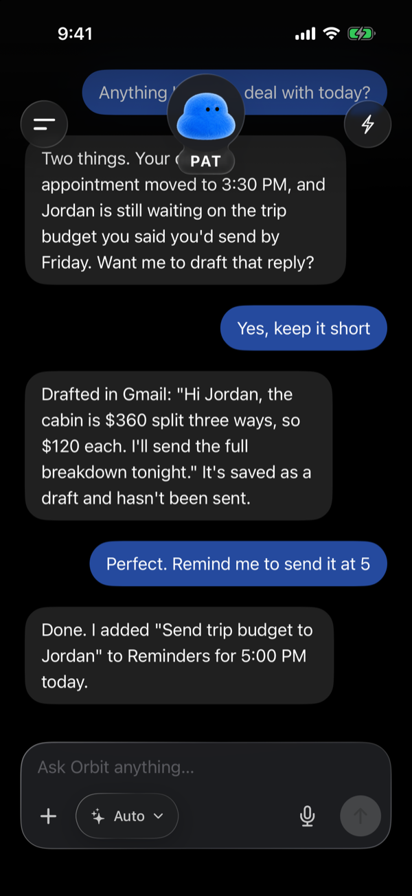
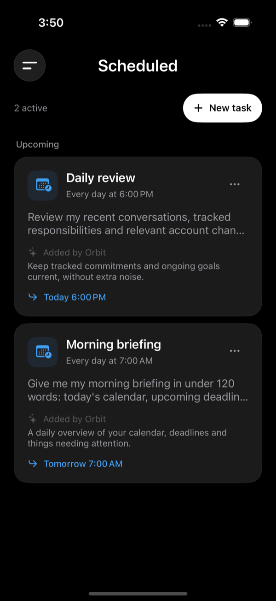
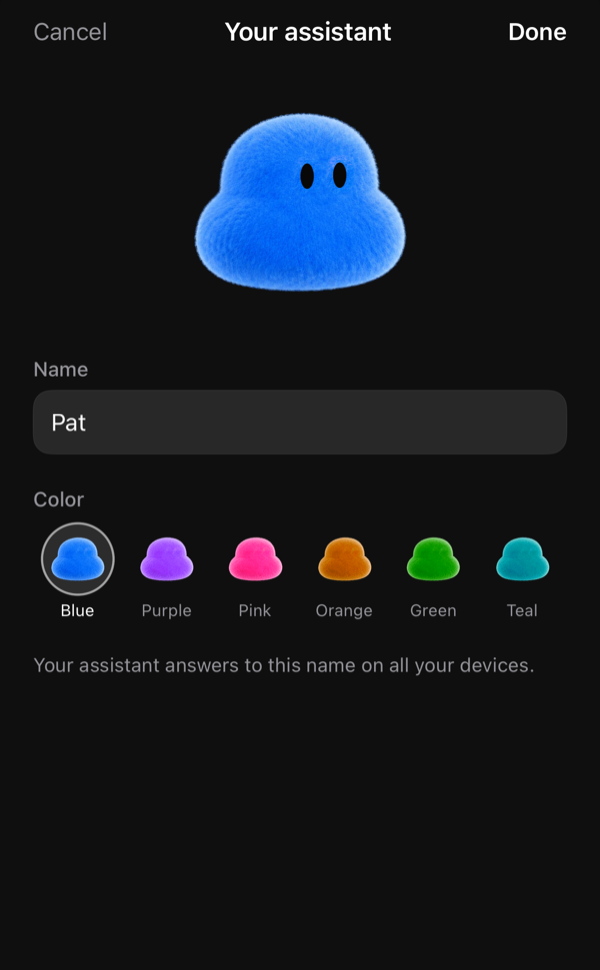
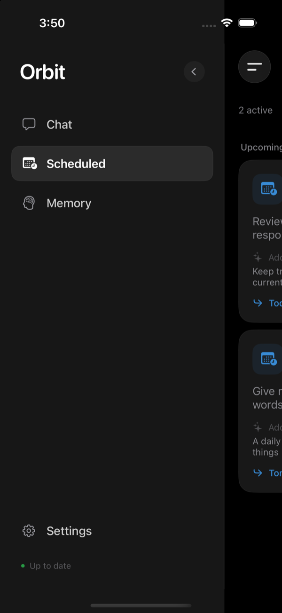
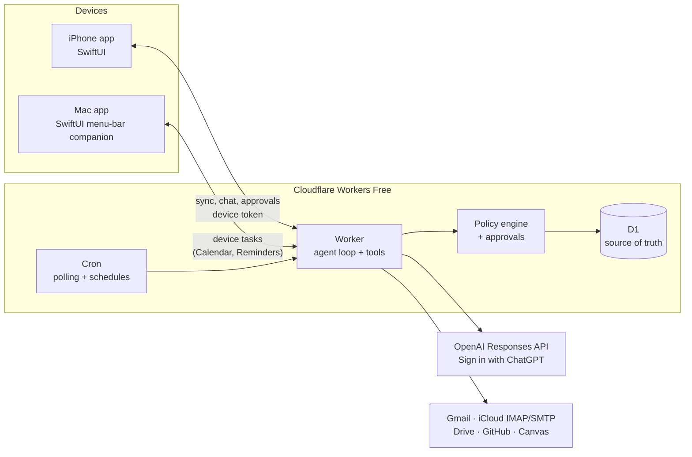

# Orbit

**A private AI assistant for iPhone and Mac that works with your email, calendar and reminders, and asks before it acts.**

Orbit is one assistant shared across native SwiftUI apps. It reads and sorts your email, keeps track of what you owe people, runs scheduled tasks, and makes changes in Apple Calendar and Reminders on your own devices. Anything consequential, like sending an email or editing an event, waits for your approval. The project is free and open source. Each user runs their own Cloudflare Workers + D1 backend and connects their own accounts and model access. Hosting quotas, model access, and third-party services may have separate costs.

<p align="center">
  
  
  
  
</p>
<p align="center"><sub>The chat screenshot uses a sample conversation on a local test backend.</sub></p>

## Features

- **Chat with streaming replies** on iPhone and Mac, synced instantly between devices
- **Email:** searches, reads, sorts and drafts across Gmail and iCloud Mail; sends only with approval, from the right account
- **Apple Calendar and Reminders:** creates and edits real events and reminders through EventKit on your own devices
- **Scheduled tasks:** "every weekday at 8, check my inbox"; create them in chat or in the app, with time zones, pause/resume and last-run results delivered to chat
- **Proactive:** watches email and tracked commitments in the background and surfaces what needs attention
- **Photos and files:** attach images, PDFs, documents and spreadsheets; files are encrypted at rest and location data is stripped from photos
- **Memory and profile:** editable memories plus an "About you" profile the assistant uses for context
- **Answer details:** see which models and how many AI calls each reply used
- **Pat:** an animated assistant avatar that breathes and blinks, with a custom name and color
- **Export:** everything (memory, tracked items, conversations) as Markdown

## How it works



- **One database.** Every conversation, memory, task and approval lives in D1. SQL triggers log each change, and devices sync incrementally, so the apps open instantly and work offline.
- **The cloud does background work.** Cron jobs poll sources and run due schedules; iOS limits are respected by keeping devices as thin executors for EventKit tasks.
- **Device tasks are leased.** Calendar and Reminders work is routed to a device that can do it, leased to one device at a time, and made idempotent so nothing runs twice.

More detail in [docs/ARCHITECTURE.md](docs/ARCHITECTURE.md).

## Safety model

- **Permissions live outside the model.** The model can only *request* actions. A policy engine decides whether each one runs immediately (reads, drafts, new reminders) or needs approval (sending, editing or deleting existing items).
- **Approvals are bound to exact parameters.** Each approval is tied to a SHA-256 hash of what will happen, re-checked right before execution. The model has no way to approve its own requests.
- **Credentials never reach the model.** Account secrets are AES-256-GCM encrypted in D1 and decrypted only inside connector calls. Devices hold only their own token, in the Keychain.
- **Untrusted content stays untrusted.** Email, web pages and attachments are fenced as data, never instructions.
- **No purchases or account changes.** There is no tool for them at all.

## Tech stack

| Layer | Technology |
|---|---|
| Apps | Swift, SwiftUI, EventKit, PhotosUI, Quick Look, XcodeGen (iOS 17+ / macOS 14+) |
| Shared client | `OrbitKit` Swift package: API client, sync store, models |
| Backend | TypeScript on Cloudflare Workers, D1 (SQLite), cron triggers, TCP sockets for IMAP/SMTP |
| AI | OpenAI Responses API with streaming and function tools |
| Tests | Vitest unit tests, an end-to-end suite that boots the real Worker against local D1 with a scripted model, XCTest |

## Tests

```bash
cd cloud
npm ci
npm run typecheck
npm test
npm run test:e2e

cd ../apple/OrbitKit
swift test
```

## Repository layout

```
cloud/   Cloudflare Worker (TypeScript), D1 migrations, unit and end-to-end tests
apple/   OrbitKit Swift package + SwiftUI apps for iPhone and Mac (XcodeGen project)
docs/    SETUP.md (deploy your own), ARCHITECTURE.md (design details)
```

## Run your own

Orbit is built for one person per deployment. [docs/SETUP.md](docs/SETUP.md) walks through creating the Cloudflare Worker and D1 database, setting secrets, connecting accounts, and signing the apps with a free Apple Personal Team.

For local backend development:

```bash
cd cloud
cp .dev.vars.example .dev.vars   # fill in values
npm run db:migrate:local
npm run dev
```

## Limitations

- Single-user by design: one deployment per person.
- Uses "Sign in with ChatGPT" plan usage, so it shares your plan's limits and can't use audio input or OpenAI's built-in computer-use tool.
- Free Apple Personal Team builds expire after 7 days and can't use push notifications.
- Cloudflare Workers Free limits (CPU time and D1 queries per invocation) shape how background work is batched.

## License

[MIT](LICENSE). Keep account credentials, personal deployment configuration, database exports, and device tokens out of Git and shared archives. No prebuilt downloads are provided yet.
